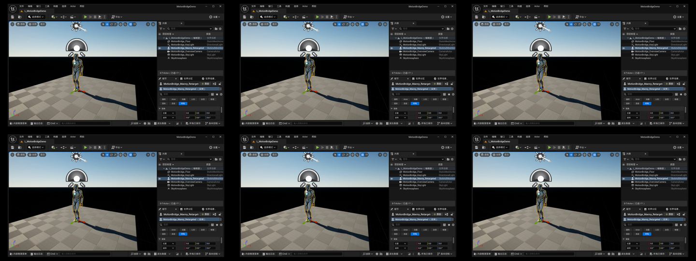
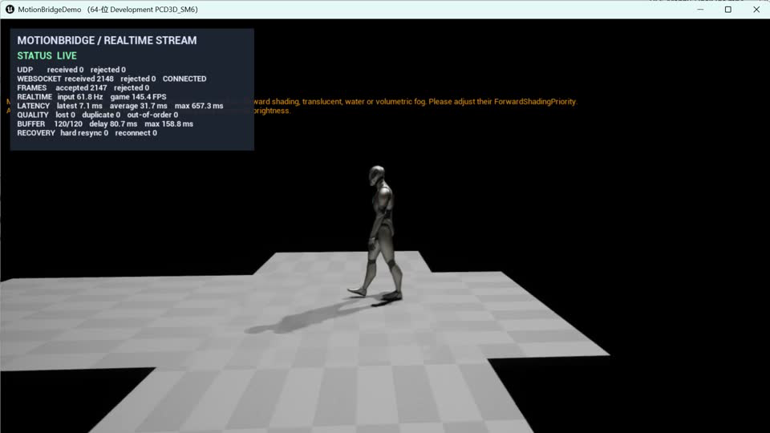

# MotionBridge UE

MotionBridge UE is a technical project for real-time character animation. It connects offline BVH processing and Unreal retargeting with runtime UDP/WebSocket streaming, root motion, foot IK, monitoring, reconnection, and Morph Target facial control.



[](artifacts/candidates/MotionBridge_WebSocket_Manny_Final.mp4)

Click the image to view an actual runtime capture. Python streams an 89-bone pose at approximately 60 Hz, while Unreal handles WebSocket ingestion, buffering, interpolation, Pose Snapshot application, root motion, and foot IK. The visible jump at the end is the boundary of the finite looping motion clip, not a disconnect or packet-loss event.

## Highlights

- Custom BVH tokenizer, parser, channel decoder, and forward kinematics implementation.
- Reproducible Blender/FBX/Unreal pipeline and UE IK Retargeter assets for UE5 Manny.
- Root-motion extraction with frame-by-frame world-pose reconstruction tests.
- Runtime root motion applied through `CharacterMovement`, avoiding mesh/capsule divergence and double consumption.
- C++ foot IK with heel/toe traces, pelvis compensation, Two Bone IK, ground-normal alignment, and frame-rate-independent smoothing.
- Shared versioned JSON ingestion for UDP and WebSocket transports, including validation, bounded buffering, interpolation, timeout fallback, and recovery.
- Network callbacks enqueue raw messages; Unreal objects are changed only on the game thread.
- Realtime scalar channels drive four Morph Targets on an original test character.
- Native C++ UMG diagnostics for connection state, input rate, FPS, end-to-end latency, packet quality, buffer delay, and reconnect count.

## Architecture

```text
BVH -> custom parser/decoder/FK -> validation and visualization
  \-> Blender/FBX -> UE source skeleton -> IK Retargeter -> Manny
                                                  \-> root motion
                                                  \-> foot IK

Python UDP/WebSocket source
  -> callback/network thread
  -> MPSC raw-message queue
  -> game-thread validation and time-sorted buffer
  -> interpolation
     ├─ local bone pose -> Pose Snapshot -> AnimGraph
     ├─ root motion -> CharacterMovement
     └─ scalar channels -> Morph Target driver
  -> C++ UMG diagnostics and automated acceptance logs
```

## Verified results

- 50/50 Python tests pass.
- 7/7 C++ motion-system tests build and exit successfully.
- Unreal Engine 5.6 Game and Editor targets build successfully.
- UDP playback reproduces 69 frames over 89 Manny bones with `0.000` final local rotation/translation error.
- WebSocket loopback runs at `59.99 Hz` over 89 bones with zero rejected frames; the pose reached Manny with `0.000°` measured spine error.
- Forced server disconnects were recovered automatically three times while the 89-bone pose stream resumed.
- Four Morph Targets were mapped and driven with zero missing channels.
- On a 10-degree slope, both feet matched `10.000°`; minimum sole clearances were `+0.194 / +0.200 cm`.

See [docs/final_acceptance.md](docs/final_acceptance.md) for commands and evidence.

## Quick start

Requirements: Unreal Engine 5.6, Visual Studio 2022 with C++ game development tools, and Python 3.12.

```powershell
py -3.12 -m pip install -r requirements.txt
.\scripts\setup_unreal_demo.ps1 -EngineRoot "C:\Program Files\Epic Games\UE_5.6"
.\scripts\run_websocket_demo.ps1 -FacialDemo
```

Run build and unit acceptance from a clean CMake configuration:

```powershell
.\scripts\run_acceptance.ps1
```

Include live WebSocket, reconnect, and Morph Target integration tests with:

```powershell
.\scripts\run_acceptance.ps1 -RunRealtime
```

## Implementation scope

- The project implements BVH/FK, root-motion processing, runtime ingestion and buffering, thread handoff, foot IK, diagnostics, and Morph-channel driving.
- Cross-skeleton motion mapping uses Unreal Engine's IK Retargeter.
- Public motion samples use the CC BY 4.0 100STYLE dataset; latency figures come from local loopback tests.

Project code is released under the [MIT License](LICENSE). Third-party data and
Epic Games assets are documented in [THIRD_PARTY_NOTICES.md](THIRD_PARTY_NOTICES.md).
