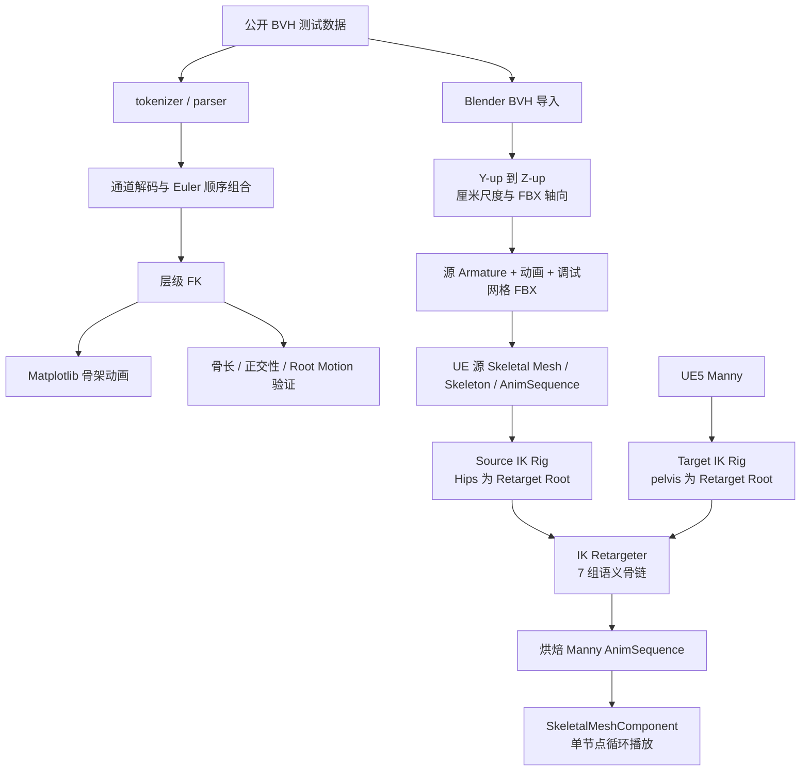

# 离线与实时动作链路架构

## 目标

离线链路从一条可验证闭环开始：读取公开 BVH，解析并验证动画数学，
再通过 Blender 和 UE5 将同一动作重定向到 Manny。实时传输和运行时重定向
不属于本周实现范围。

## 总体架构



## 两条分支的边界

### 解析与 FK 分支

负责：

- 解析 `HIERARCHY`、`OFFSET`、`CHANNELS` 和 `MOTION`；
- 严格按照每个关节声明的 Euler 通道顺序组合旋转；
- 从局部 Transform 递归计算世界 Transform；
- 输出骨架动画并检查骨长、旋转矩阵和 Root Motion。

这条分支证明对数据格式和动画数学的理解，但当前不负责导出 UE 资产。

### Blender 与 UE 分支

负责：

- 将同一份 BVH 转换为 UE 易于导入的 FBX；
- 创建源 Skeleton、Skeletal Mesh 和 AnimSequence；
- 为源骨架和 Manny 分别定义 Root、Spine、Neck、双臂和双腿七条链；
- 使用 UE 内置 IK Retargeter 迁移动作并烘焙目标动画；
- 在演示关卡中循环播放 Manny AnimSequence。

这条分支使用 Blender 与 UE IK Retargeter 完成跨骨架资产生产。

## 重定向映射

| 语义链 | BVH 源骨架 | UE5 Manny |
|---|---|---|
| Root | Hips -> Hips | pelvis -> pelvis |
| Spine | Spine -> Spine2 | spine_01 -> spine_05 |
| Neck | Neck -> head | neck_01 -> head |
| LeftArm | LeftShoulder -> LeftHand | clavicle_l -> hand_l |
| RightArm | RightShoulder -> RightHand | clavicle_r -> hand_r |
| LeftLeg | LeftUpLeg -> LeftToeBase | thigh_l -> ball_l |
| RightLeg | RightUpLeg -> RightToeBase | thigh_r -> ball_r |

链名提供人体语义对应；链内部不同的骨骼名称、数量、长度和参考姿势由
Retargeter 根据当前设置适配。当前没有配置 IK Goal 或 IK Solver，主要使用
Root 与 FK 链重定向。

## 运行时依赖

重定向结果烘焙后，演示关卡播放的是 Manny 自己的动画轨道：

```text
MotionBridge_Manny_Retargeted (Actor)
└── SkeletalMeshComponent
    ├── UE5 Manny Skeletal Mesh
    ├── UE5 Manny Skeleton
    └── A_MotionBridgeSource_Manny (AnimSequence)
```

播放时不再读取外部 BVH，也不会逐帧运行 Blender 或 IK Retargeter。删除外部
BVH 不影响现有烘焙动画，但会失去重新构建和复现源资产的输入。

## 当前已知限制

- 仅完成一套源骨架到 Manny 的离线结果；
- 尚未系统校正 Retarget Pose、Root Motion 和脚滑；
- 未配置手指链、脚部 IK Goal 或 IK Solver；
- 最小 `UMotionBridgeReceiverComponent` 目前只是帧缓冲练习，不代表实时传输已完成；
- UE 模板二进制资源和生成的 Content 不提交到 Git，需要运行本地设置脚本复现。
