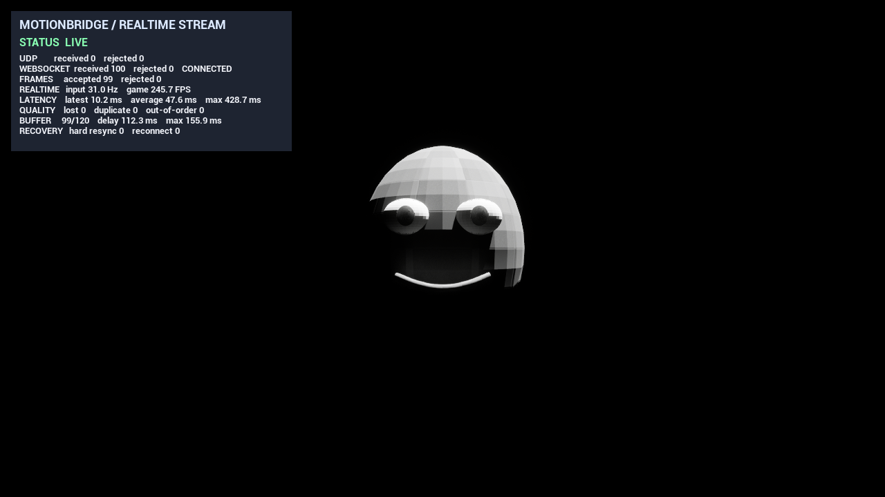

# MotionBridge UE 最终验收报告

验收日期：2026-10-20（Asia/Shanghai）

## 结论

核心求职作品闭环通过。离线 BVH/FK、Blender/FBX、UE 重定向、Root Motion、Foot IK、第三人称客户端、UDP/WebSocket 实时流、断流恢复、UMG 监控和 Morph Target 驱动均有代码与可重复验收证据。

## 自动化验收矩阵

| 层级 | 验收内容 | 结果 |
| --- | --- | --- |
| Python | `unittest discover` | 50 项通过 |
| C++ | CMake Release 构建 | 16 个目标通过 |
| C++ | 逐个运行 `*_lab.exe` | 16 个退出码均为 0 |
| UE | `TP_ThirdPerson` Win64 Development | Succeeded |
| UE | `MBEditor` Win64 Development | Succeeded |
| UDP | 89 骨骼真实 Manny 姿势流 | PASS，最终误差 0.000 |
| UDP | 停发 0.8 秒后重启流 | PASS，首帧位移 0.000 cm |
| WebSocket | 稳态输入 | PASS，拒绝 0 |
| WebSocket | 每 50 帧强制断线 | PASS，自动重连 2 次 |
| Morph | 四通道实时驱动 | PASS，映射 4、缺失 0 |
| 客户端 | 移动、跳跃、落地、相机、AnimInstance | PASS |

## 本次实际执行命令

Python：

```powershell
py -3.12 -m unittest discover -s python -p "test_*.py"
```

结果：

```text
Ran 50 tests
OK
```

C++：

```powershell
cmake -S . -B build-vs -A x64
cmake --build build-vs --config Release
```

随后逐个执行 `build-vs/Release/*_lab.exe`，16 个程序全部返回 0。覆盖变换、四元数、所有权、骨架结构、算法题、Root/缓冲、Foot IK 与 LRU 等实验。

UE：

```powershell
Build.bat TP_ThirdPerson Win64 Development MotionBridgeDemo.uproject -WaitMutex -FromMsBuild
Build.bat MBEditor Win64 Development MotionBridgeDemo.uproject -WaitMutex -FromMsBuild
```

两个 Target 均为 `Result: Succeeded`。

WebSocket、重连和 Morph Target 端到端回归统一由以下脚本启动真实 Python
服务与 UE NullRHI 实例，并检查日志通过标记：

```powershell
.\scripts\run_realtime_acceptance.ps1
```

## 实时系统证据

### WebSocket 稳态

```text
MOTIONBRIDGE_WEBSOCKET_TEST=PASS
messages=72 rejected=0 accepted=71
input_hz=26.99 game_fps=1794.11
latency_latest_ms=14.92 latency_average_ms=36.76 latency_max_ms=170.24
latency_samples=71 reconnects=0 connected=1
```

### WebSocket 重连

服务端配置为每 50 帧主动断开：

```text
MOTIONBRIDGE_WEBSOCKET_RECONNECT_TEST=PASS
messages=102 rejected=0 accepted=50 reconnects=2 connected=1
```

### Morph Target

```text
MOTIONBRIDGE_MORPH_TARGET_TEST=PASS
mapped=4 missing=0
smile=0.998 jaw_open=0.496 blink_left=0.926 blink_right=0.926
```

下图是标量通道与监控面板的技术验收截图；简化头像不是作品级数字人资产：



## 动画质量证据

- Root Motion 输入水平跨度 `91.866 cm`，Actor/胶囊峰值移动 `91.736 cm`。
- 平地自然步态完整周期约前进 `660 cm`，左右支撑脚最大漂移约 `2.665 / 2.762 cm`。
- 10° 斜坡上两脚最大地面倾角均为 `10.000°`；IK 后鞋底最小有符号间隙 `+0.194 / +0.200 cm`。
- 可公开分发的动作主线使用 CC BY 4.0 的 100STYLE 数据，Manny 重定向演示见 `artifacts/ue_manny_retarget.mp4`。

## 已知限制

- UE IK Retargeter 是引擎能力，不是自研重定向求解器。
- 表情测试头像和四通道波形用于系统验收，不代表生产级面捕或语音驱动算法。
- 延迟测量来自同机回环，跨机器部署需时钟同步并重新测试。
- 最终投递前仍需录制一条统一的 2–3 分钟成片，并由作者完成不看稿的项目讲解演练。
